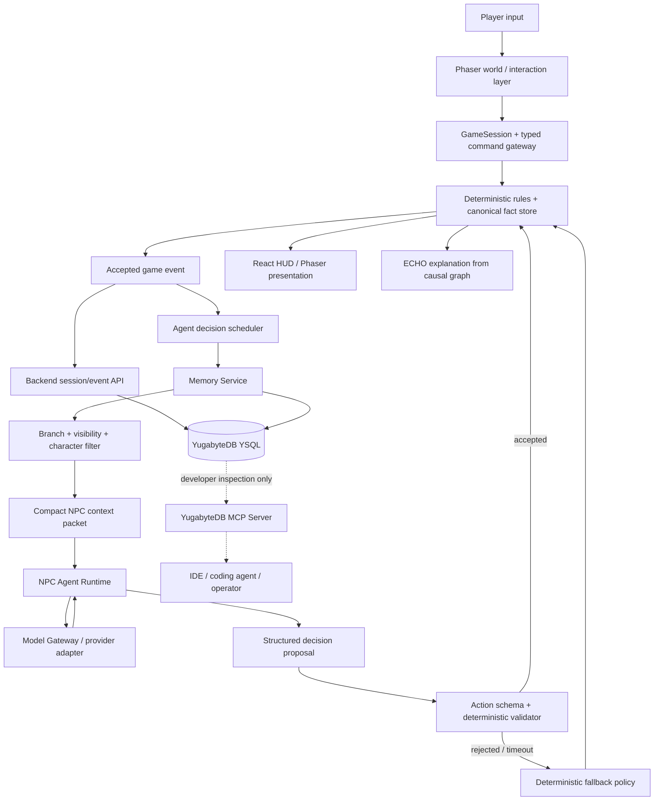

# THE LAST BLINK — Agentic NPC, Collective Memory & Team Execution Blueprint

**Revision:** 0.1 — 31 October 2026  
**Status:** Architecture proposal for review; not a claim that any component has already been implemented  
**Project:** *The Last Blink: Second Settlement*  
**Purpose:** Freeze the architecture, ownership boundaries, data contracts, memory rules, provider-failure strategy and integration workflow before parallel implementation begins.

---

## 0. Executive decision

The project can evolve from a mostly authored NPC experience into a **hybrid agentic character simulation**. The recommended design is not “one LLM call for every NPC every frame,” and it is not one unrestricted hive mind that lets every character know everything.

Build a shared **World Memory Layer** backed by YugabyteDB, but give each NPC a filtered, character-specific view of that memory. Every NPC can have its own persona, goals, beliefs, relationship state and episodic memories. Characters may share information only through an in-world channel or an explicitly permitted system channel. The database stores what happened; it does not decide what is true in the game or what an NPC is allowed to know.

Use deterministic game rules as the final authority. AI agents propose dialogue, goals and bounded actions. A deterministic validator checks every proposal before it can change the game. MORROW remains the in-world CivicLink security/continuity AI and a strategic antagonist; it should not silently puppet every civilian. The technical NPC Agent Runtime is a separate game service that schedules and arbitrates character agents.

**Recommended architecture decisions:**

1. **One repository, one canonical game state, one event contract.** Workstreams are separated by module ownership and interfaces, not by creating separate copies of the project.
2. **YugabyteDB is durable shared memory and transactional history.** Use YSQL for events, branch lineage, facts, relationships and memory metadata. Evaluate YugabyteDB's pgvector support for semantic recall after a small compatibility spike.
3. **Use the YugabyteDB MCP Server primarily for developer/operations tooling.** The running game should access YugabyteDB through a narrow backend Memory Service using a PostgreSQL-compatible YSQL driver, not by giving each NPC a general-purpose SQL tool.
4. **NPC cognition is event-driven, not frame-driven.** LLM calls occur at meaningful decision points. Deterministic movement, collision, patrol execution and common ambient behaviour remain local.
5. **Separate truth, belief and memory.** The world fact store is authoritative. NPC beliefs may be incomplete or wrong. Memories point back to source events.
6. **BLINK is branch-aware.** A new timeline must not accidentally retrieve memories from the discarded future. Only explicitly whitelisted scar memories cross a rewind.
7. **No API-limit bypassing.** Use a central model gateway, quotas, queues, caching, bounded retries, local fallback and provider-approved quota increases or failover.

This extends the existing *Last Blink* concept (RIN, ECHO, MORROW, JAYA, IVO, DR. SEN, ORIN, Northstar, CivicLink and BLINK) while deliberately revising its earlier assumption that the named NPCs are mostly authored and only MORROW has a learned tactical policy.

## 1. What “collective hive-mind memory” should mean

The useful version of the idea is a **shared event-and-knowledge substrate with controlled character viewpoints**.

### 1.1 Four kinds of information

| Layer | What it contains | Who owns it | Can an LLM change it? |
|---|---|---|---|
| Canonical world truth | Settlement state, evidence validity, route gates, timeline anchors, objective completion, causal facts | Deterministic Game/Story Engine | No. An agent may request a legal action; rules decide the resulting truth. |
| Shared world events | What happened in the active branch: a receipt was found, a door opened, an NPC made a promise, a payment was held | Event Store / Memory Service | Agents may propose memory summaries; accepted events are recorded by the backend. |
| Character belief and memory | What Jaya knows, what Ivo suspects, what Dr. Sen trusts, what Orin was told, what MORROW observed | Per-character memory view | Yes, through validated memory updates with source-event references and access rules. |
| Short-lived working context | Current goal, current conversation, nearby stimuli, recent events, next planned action | Agent Runtime / in-memory session state | Yes, but it expires and is not automatically permanent memory. |

Do not collapse these into one giant vector store. A semantically similar memory is not necessarily a true fact, and a true world fact is not automatically known to every character.

### 1.2 A character must not be omniscient

The Memory Service should answer questions such as:

- What did this NPC personally observe?
- What did someone tell this NPC, and who told them?
- What public announcements or network records can this NPC access?
- What does the NPC believe, and how confident are they?
- Which events are visible in this branch and before the current simulation point?
- Which facts are forbidden because they are private, hidden, from another branch or not yet discovered?

An NPC should not receive raw unrestricted database access. It should receive a compact, filtered memory packet created by the Memory Service.

### 1.3 Information-sharing rules

Use explicit visibility classes, for example:

- `PUBLIC_WORLD`: public announcements, visible events and information everyone could reasonably observe.
- `FACTION`: facts shared with a named organisation or group.
- `CHARACTER_PRIVATE`: a private observation, conversation or personal memory.
- `SYSTEM_SECURITY`: sensor/log data available to MORROW because the fiction grants that access.
- `PLAYER_SCAR`: information RIN carries across BLINK, if allowed by the narrative rules.
- `EXPLICITLY_SHARED`: a memory transferred by a recorded conversation, message or data handoff.

A character-to-character disclosure must create a transfer event. Do not simply make another NPC's memory query return the source NPC's private memory.

### 1.4 Keep MORROW's fictional role distinct from the runtime

There are two different concepts:

- **MORROW (in the story):** CivicLink's risk-and-continuity AI. It has access to the system signals justified by the fiction, directs security assets, responds to the investigator's behaviour and embodies the flawed objective function at the heart of the incident.
- **NPC Agent Runtime (in the software):** the out-of-world coordinator that schedules Jaya, Ivo, Dr. Sen, Orin, MORROW and other actor policies, retrieves each actor's memory and validates proposals.

MORROW may influence the world through legitimate in-fiction mechanisms—security patrols, terminal restrictions, policy decisions, public notices and automated settlement controls. It should not arbitrarily control what a civilian thinks or says. That distinction preserves character agency and makes the antagonist more interesting.

If the intended story twist is that MORROW has been steering people through CivicLink recommendations, represent that as a discoverable influence mechanism with evidence and limits—not as unrestricted mind control.

## 2. Recommended system architecture



### 2.1 Main layers and responsibilities

| Layer | Owns | Must not own |
|---|---|---|
| Phaser client | Movement, collision, map, sprite animation, patrol movement execution, interaction zones | Canonical financial facts, direct database writes, unrestricted LLM calls |
| React HUD | Dialogue, evidence drawer, timeline, settings, debrief and agent status presentation | Direct world-state mutation |
| GameSession / Command Gateway | Typed commands, session/branch identity, validation entry point, stable event IDs | LLM prompt construction or arbitrary SQL |
| Deterministic Story Engine | Fact store, preconditions/effects, causal graph, choices, anchors, ending calculation | Probabilistic story truth |
| NPC Agent Runtime | Scheduling, per-character context, short-term goals, selecting a decision strategy, structured proposal handling | Direct mutation of world truth or unfiltered database access |
| MORROW policy | Security tactics, observation interpretation and permitted in-fiction system actions | Rewriting story facts or permanently blocking required progress |
| ECHO | Explain already-recorded facts and causal dependencies; point to missing evidence | Inventing evidence or setting flags |
| Memory Service | Filtered memory retrieval, memory creation, summaries, visibility, branch inheritance and provenance | Deciding the canonical result of gameplay |
| Model Gateway | Global provider limits, queues, timeouts, retries, caching, budgets and provider selection | Game rules or NPC knowledge policy |
| Node API + YugabyteDB | Durable event history, session/branch data, memory records, relationships and audit history | Per-frame simulation |

### 2.2 One authority for every decision

The final state-changing path is:

1. An NPC agent receives a bounded observation and proposes an action from the allowed action catalogue.
2. The proposal is schema-validated and checked against the current branch, NPC capabilities, preconditions, cooldowns and story invariants.
3. If valid, the deterministic engine applies it and emits an accepted event.
4. If invalid, stale or late, the engine rejects it and uses a fallback or requests a new decision.
5. The Memory Service records the accepted event and only the memories that are justified by it.

The LLM does not receive a `set_world_fact` tool. It cannot invent evidence IDs, commit settlement state, unlock the audit gateway, spend BLINK charges or choose an ending directly.

## 3. NPC cognition model

Use a tiered policy so the game remains playable when the model API is slow or unavailable.

| Tier | Mechanism | When to use it | Example |
|---|---|---|---|
| 0 — Simulation | Deterministic movement, physics, timers and state reducers | Every frame / simulation tick | An NPC walks to its authored waypoint. |
| 1 — Routine behaviour | Behaviour tree, utility score or finite-state machine | Frequent, predictable actions | Ivo follows his route; Jaya returns to her stall. |
| 2 — Tactical policy | PPO or a deterministic tactical selector | Bounded security decisions with a measurable state/action space | MORROW selects PATROL, INVESTIGATE_NOISE or INTERCEPT_ROUTE. |
| 3 — Agentic reasoning | LLM with character-specific context and a restricted action catalogue | Meaningful conversations, changing plans, difficult social decisions and significant events | Jaya decides whether to disclose a receipt after considering trust and what she knows. |
| 4 — Narrative authority | Deterministic story rules and authored content | Every consequential state transition and ending | A scoped policy patch is available only if required evidence exists. |

Do not invoke Tier 3 for every movement or patrol tick. A sensible first implementation uses Tier 0–2 constantly and Tier 3 only on important events.

### 3.1 Character agent definition

Every named NPC should have a data-driven definition, not a separate hand-written agent implementation.

```ts
export type NpcDefinition = {
  npcId: string;
  displayName: string;
  personaVersion: string;
  role: string;
  stableTraits: string[];
  goals: Array<{ goalId: string; priority: number; preconditions: string[] }>;
  fears: string[];
  values: string[];
  capabilities: string[];
  forbiddenActions: string[];
  knowledgeScopes: string[];
  memoryPolicy: {
    retainEventTypes: string[];
    visibilityScopes: string[];
    maxWorkingMemories: number;
  };
  decisionPolicy: "deterministic" | "hybrid" | "llm_triggered";
  fallbackPolicyId: string;
};
```

Keep persona definitions in versioned content data. An NPC's stable personality should not drift because the last model response changed its prompt.

### 3.2 NPC-specific behaviour intent

| Character | Agentic opportunity | Hard boundary |
|---|---|---|
| JAYA | Trust, disclosure, merchant priorities, reaction to a hold or release | Cannot reveal private merchant records unless the evidence-sharing rules allow it |
| IVO | Route knowledge, dispatch explanation, suspicion, willingness to help | Cannot fabricate timestamps or dispatch evidence |
| DR. SEN | Clinical continuity, privacy, supplier choices, trust in the investigator | Cannot falsify a record or claim a delivery was verified without proof |
| ORIN | Route access, audit trail protection, technical interpretation | Cannot bypass a gate unless the deterministic route conditions are met |
| MORROW | Adaptive security strategy, risk posture, policy arguments and antagonist dialogue | Cannot control civilian minds, invent underlying evidence or violate required route/anchor invariants |
| ECHO | Evidence-grounded explanations and unresolved dependency hints | Cannot create facts, change relationships or decide an ending |

### 3.3 Decision cadence

Trigger an agent decision only when one of these occurs:

- A player initiates a meaningful conversation.
- An NPC witnesses a relevant, new event.
- A goal precondition changes.
- A relationship threshold is crossed.
- An NPC receives a verified message or evidence handoff.
- MORROW observes a meaningful change in player tactics.
- A branch is created and the NPC's allowed memory view changes.

Routine pathing, idle lines, ambient crowd responses and simple patrol movement should use local rules or cached plans.

## 4. Collective memory and YugabyteDB design

### 4.1 What belongs in the database

Persist meaningful events and long-term memory. Keep frame-by-frame data in the client or runtime cache.

**Persist:** accepted player choices, evidence discoveries, accepted NPC actions, dialogue disclosures that affect knowledge, relationship changes, branch forks, anchor validation, important MORROW tactics, policy changes and ending commits.

**Do not persist every frame:** coordinates each render tick, animation frames, footstep particles, temporary steering vectors, every idle bark or repeated copies of the same observation.

### 4.2 Proposed logical tables

These are logical design targets, not final migrations. Confirm data types, indexes, key layout and YugabyteDB version with a small schema spike before writing production migrations.

| Table | Purpose | Important fields |
|---|---|---|
| `game_sessions` | Run/session identity and active branch | `session_id`, `active_branch_id`, `state_version`, `created_at` |
| `timeline_branches` | Immutable branch lineage | `branch_id`, `session_id`, `parent_branch_id`, `fork_event_id`, `fork_sequence`, `status` |
| `game_events` | Canonical append-only event history | `event_id`, `session_id`, `branch_id`, `sequence_no`, `event_type`, `actor_id`, `payload`, `created_at`, `idempotency_key` |
| `world_facts` | Materialised current facts for a branch | `session_id`, `branch_id`, `fact_key`, `fact_value`, `source_event_id`, `version` |
| `npc_memories` | Episodic/semantic character memories | `memory_id`, `session_id`, `branch_id`, `npc_id`, `source_event_id`, `memory_type`, `summary`, `content`, `visibility_scope`, `importance`, `confidence`, `created_at` |
| `npc_beliefs` | Subjective character beliefs with provenance | `npc_id`, `branch_id`, `proposition_key`, `belief_value`, `confidence`, `source_memory_id`, `updated_sequence` |
| `npc_relationships` | Relationship state between characters | `session_id`, `branch_id`, `npc_a`, `npc_b`, `trust`, `respect`, `tension`, `version` |
| `npc_runtime_state` | Small durable checkpoints for goals and state | `session_id`, `branch_id`, `npc_id`, `goal_state`, `last_decision_id`, `version` |
| `memory_embeddings` | Semantic search vectors, linked to a memory | `memory_id`, `embedding_model`, `embedding_version`, `embedding` |
| `memory_transfers` | Explicit communication/knowledge transfer | `transfer_id`, `source_npc_id`, `target_npc_id`, `source_memory_id`, `transfer_event_id`, `branch_id` |
| `scar_memories` | Explicitly permitted cross-branch memories | `memory_id`, `source_branch_id`, `target_branch_id`, `recipient_id`, `allow_reason`, `source_event_id` |
| `agent_decisions` | Proposed and accepted/rejected agent outputs | `decision_id`, `npc_id`, `branch_id`, `trigger_event_id`, `proposal`, `validation_status`, `result_event_id` |

Add appropriate unique constraints and indexes. In particular, enforce idempotency on event creation and prevent two accepted decisions from applying against the same stale state version.

### 4.3 Memory types

- **Episodic:** “Ivo saw RIN present the dispatch trace at the Transit Yards.”
- **Semantic:** “The dispatch record's timestamp conflicts with the invoice time.” This should reference evidence and have a verification status.
- **Relationship:** “Jaya trusts RIN more after the player protected the merchant ledger.”
- **Belief:** “Ivo suspects the Northstar contact is hiding something.” A belief is not a canonical fact.
- **Working memory:** current conversation, active goal, last few relevant actions. It can be short-lived and may never be written to long-term storage.

### 4.4 Memory write pipeline

1. The deterministic engine accepts an event and commits it.
2. A memory extractor creates candidate memory records from the event and approved dialogue metadata.
3. The Memory Service applies retention, visibility, branch and source-provenance rules.
4. The structured memory record is persisted.
5. If semantic recall is enabled, an asynchronous embedding worker generates and writes the vector. The game does not wait for embedding generation to complete before accepting the original event.
6. A consolidation job may merge repetitive memories into a summary, but it must preserve source-event references and must not rewrite the event log.

Do not let a model turn an unverified statement into a verified world fact during memory consolidation.

### 4.5 Retrieval pipeline

For an NPC decision, retrieve in this order:

1. Filter by `session_id` and active `branch_id` ancestry.
2. Apply branch cutoff: ancestor memories must be at or before the branch fork sequence.
3. Apply `npc_id`, faction, visibility and explicit-sharing permissions.
4. Fetch the most recent working context and relevant structured facts.
5. Optionally run vector similarity over eligible memories only.
6. Rank by relevance, recency, importance and confidence.
7. Return a small context packet with `source_event_id` references.

**Important:** run access-control and branch filters before semantic ranking. Do not vector-search the whole database and filter after the model has already seen results.

### 4.6 BLINK and timeline memory isolation

The branch model must prevent future-memory leakage.

- V1 remains immutable.
- V2 starts from the checkpoint snapshot and inherits only memories valid at that checkpoint.
- Events after the fork point in V1 remain readable in V1, not in V2.
- RIN may retain explicitly whitelisted scar memories as the player's time-travel knowledge.
- MORROW may retain a limited meta-memory only if the story intentionally reveals that CivicLink's network-level monitoring leaves traces across branches.
- Ordinary NPCs do not remember the discarded future unless a story rule explicitly grants that ability.
- Every cross-branch memory must have a recipient, source, target branch and explicit reason.

This can become a strong gameplay mechanic: the player knows something from V1, while Jaya or Ivo may not. Later, MORROW might gradually infer timeline interference from permitted system traces.

### 4.7 Vector search: useful, but not the whole memory system

YugabyteDB's current documentation describes pgvector support on YSQL, including vector types and an HNSW-compatible `ybhnsw` index. Use that for semantic recall if the actual cluster version and deployment support the required extension and index behaviour. Keep relational filters and exact event references as the authority. For a tiny MVP dataset, begin with SQL metadata filtering plus exact/lexical retrieval; add vector indexing only after a working memory round-trip is proven.

The embedding model is a separate dependency and may have its own rate limits and cost. Embeddings should be generated asynchronously and only for memories worth recalling semantically, not for every telemetry event.

## 5. MCP vs application database access

The phrase “YugabyteDB MCP” needs one important distinction.

### 5.1 What the YugabyteDB MCP Server is

YugabyteDB documents an MCP server that lets compatible LLM tools inspect a database, summarise schemas and run read-only queries; guarded write queries are optional and disabled by default. It is useful for developer assistants, database exploration and controlled operator workflows.

### 5.2 What it is not

It is not itself:

- An autonomous NPC framework.
- A memory-consolidation engine.
- A shared consciousness or automatic character-to-character knowledge system.
- A way to increase an LLM provider's RPM/TPM quota.
- A safe reason to give every in-game NPC unrestricted SQL access.

### 5.3 Recommended use

- **Developer workflow:** connect the YugabyteDB MCP Server to an approved IDE/coding assistant for schema inspection, safe read-only queries and database troubleshooting.
- **Game runtime:** use a backend Memory Service and parameterised YSQL queries through a PostgreSQL-compatible Node.js driver. Expose domain methods such as `retrieveNpcMemories()` or `recordAcceptedMemory()` rather than arbitrary SQL execution.
- **Write access:** game code should use narrowly scoped service functions and DB roles. Do not enable generic SQL write tools for NPC agents.

The official Node.js driver documentation lists both the standard node-postgres driver and YugabyteDB's node-postgres Smart Driver. Choose after verifying the target cluster topology and connection requirements; a standard `pg` connection is a reasonable initial integration path for a small deployment.

## 6. Model API limits, latency and reliability

There is no responsible way to give exact RPM/TPM numbers until the provider, model, account tier, project/org limits and billing configuration are selected. Different providers—and even different models or account tiers within one provider—have different limits. We should not design around guessed quotas.

Also, **do not try to bypass limits** by rotating keys, creating hidden accounts or sending uncontrolled parallel requests. That is not a reliability strategy and may violate provider terms. The solution is to control demand and make the game degrade gracefully.

### 6.1 One Model Gateway for the entire game

All model requests pass through one server-side gateway. NPC agents do not hold provider API keys and do not call external model endpoints directly.

The gateway owns:

- Provider/model-specific request-per-minute and token-per-minute budgets.
- A token bucket or paced queue to prevent bursts.
- A maximum in-flight request count.
- Per-session and per-character budgets.
- Request prioritisation.
- Prompt and output-token ceilings.
- Duplicate-request coalescing and bounded response caching.
- Timeouts, cancellation and retry policy.
- Circuit breaker and deterministic fallback.
- Usage, latency, error and cost telemetry.

### 6.2 Suggested request priority

| Priority | Request type | Behaviour under pressure |
|---|---|---|
| P0 | Critical story interaction that blocks progress | Reserve capacity; short deadline; deterministic dialogue fallback if unavailable |
| P1 | Active named NPC decision relevant to current objective | Queue briefly; reuse last valid plan if safe; otherwise deterministic policy |
| P2 | MORROW tactical commentary or optional strategic reaction | Defer or use local/PPO policy; never block movement |
| P3 | Ambient chatter, background NPC thoughts, memory summarisation | Batch, defer or skip |

### 6.3 Demand reduction before retrying

1. Trigger on meaningful events, not frames.
2. Cache a valid NPC plan until a relevant event invalidates it.
3. Deduplicate requests using a key such as `(session, branch, npc, trigger_event, state_version, decision_kind)`.
4. Retrieve only the top few relevant memories; do not send a character's complete history every time.
5. Summarise older memories into compact, source-linked records.
6. Keep output schemas small and cap output tokens.
7. Reuse stable persona instructions and provider prompt caching where the selected provider supports it; treat caching as an optimisation, not a correctness dependency.
8. Use deterministic utility/behaviour policies for routine decisions.
9. Run embedding and memory-consolidation jobs asynchronously.
10. Track both request count and token consumption; staying under RPM does not guarantee staying under TPM.

### 6.4 Retry and circuit-breaker policy

- If the provider sends `Retry-After`, wait at least that long.
- Otherwise use exponential backoff with jitter and a small, bounded retry count.
- Retry transient rate-limit, network and server-overload errors only when the request deadline still permits it.
- Do not repeatedly retry invalid requests, authentication failures, policy refusals or exhausted billing/quota conditions.
- Do not stack multiple independent retry loops in the SDK and application without accounting for their combined attempts.
- After repeated failures, open a circuit breaker for that provider/model and use fallback until a health check permits recovery.
- Do not let a retry queue block the game loop.

### 6.5 Fallback ladder

1. Cached valid decision for the same character and compatible state version.
2. Character-specific deterministic utility policy / behaviour tree.
3. Authored dialogue template selected from state and relationship tags.
4. A clear in-character fallback line such as “I need to check the record before I answer.”
5. Continue gameplay without waiting for the AI service.

The player must always be able to move, inspect already-found evidence and reach a valid ending if the external model API is down.

### 6.6 Observability and quota acceptance tests

Record at least:

- Requests by provider, model, NPC, trigger and session.
- Input/output tokens and estimated spend.
- Queue wait, request latency and timeout count.
- 429/5xx/error-code distribution.
- Cache hit and duplicate-coalescing rates.
- Fallback frequency and which NPCs used it.
- Invalid structured proposals and validator rejection reasons.

Before selecting the provider, make a small load-test sheet using the actual account's documented limits. Test bursts, sustained traffic, 429 responses, timeouts and quota exhaustion separately. Exact provider limits are a deployment input, not a number to guess in this design document.

## 7. Shared contracts: freeze these before parallel development

The most important integration decision is to publish a small set of contracts before contributors build their modules.

### 7.1 Canonical event contract

```ts
export type GameEvent<TPayload = unknown> = {
  eventId: string;             // stable UUID; unique per accepted event
  sessionId: string;
  branchId: string;
  sequenceNo: number;          // monotonically increasing inside the branch
  stateVersion: number;
  tick: number;
  eventType: string;           // e.g. EVIDENCE_DISCOVERED, NPC_DISCLOSURE
  actorId: string;
  targetId?: string;
  payload: TPayload;
  source: "player" | "npc" | "morrow" | "system";
  occurredAt: string;
  idempotencyKey: string;
};
```

### 7.2 NPC observation contract

```ts
export type NpcObservation = {
  sessionId: string;
  branchId: string;
  stateVersion: number;
  triggerEventId: string;
  npcId: string;
  locationId: string;
  currentGoalIds: string[];
  visibleWorldFacts: Array<{ key: string; value: unknown; sourceEventId: string }>;
  recentEvents: GameEvent[];
  retrievedMemories: Array<{
    memoryId: string;
    summary: string;
    confidence: number;
    sourceEventIds: string[];
    visibilityScope: string;
  }>;
  allowedActions: string[];
  deadlineMs: number;
};
```

### 7.3 Agent proposal contract

```ts
export type NpcDecisionProposal = {
  decisionId: string;
  npcId: string;
  branchId: string;
  basedOnStateVersion: number;
  triggerEventId: string;
  intent: string;
  action: {
    type: string;              // must be in the supplied allow-list
    targetId?: string;
    parameters?: Record<string, unknown>;
  };
  dialogue?: {
    dialogueKey?: string;
    text?: string;
  };
  memoryCandidates?: Array<{
    summary: string;
    sourceEventIds: string[];
    memoryType: "episodic" | "belief" | "relationship";
    visibilityScope: string;
  }>;
  expiresAt: string;
};
```

The model response is a **proposal**. The server checks the actor ID, branch, state version, action allow-list, target, preconditions, memory sources and expiration time. Free-form output must never be executed as code or SQL.

### 7.4 Shared event catalogue

Create and version an `EVENT_CATALOG.md` with every event type, required fields, producer, consumers, persistence rule and whether it is branch-local. Examples:

- `PLAYER_INTERACTED`
- `EVIDENCE_DISCOVERED`
- `EVIDENCE_VERIFIED`
- `NPC_CONVERSATION_STARTED`
- `NPC_DISCLOSURE_ACCEPTED`
- `NPC_RELATIONSHIP_CHANGED`
- `NPC_DECISION_PROPOSED`
- `NPC_ACTION_ACCEPTED`
- `NPC_ACTION_REJECTED`
- `MORROW_TACTIC_SELECTED`
- `SETTLEMENT_HELD`
- `POLICY_PATCH_APPLIED`
- `BLINK_BRANCH_CREATED`
- `ANCHOR_VALIDATION_FAILED`
- `ENDING_COMMITTED`

Do not create near-duplicate event names in separate modules. The contract owner approves additions.

## 8. Parallel team structure without code fragmentation

Use **one Git repository and one shared architecture**. Divide work by bounded modules, data ownership and deliverables. If AI coding agents are used, each should receive a task contract and a path allow-list, and work in a separate Git worktree/feature branch of the same repository.

### 8.1 Workstreams

| Workstream | Owns | Deliverables | Must not edit / decide |
|---|---|---|---|
| A. Architecture + Integration Lead | Shared contracts, repository boundaries, branch policy, dependency integration, system-level review | `ARCHITECTURE.md`, contracts, event catalogue, ADRs, integration checklist, release tags | Should not casually rewrite another workstream's module implementation |
| B. Gameplay Mechanics Engineer | Phaser world, player movement, collisions, map, interaction zones, HUD event bridge, presentation of accepted NPC actions | Playable district, interaction flow, client state adapter, mechanics tests | No direct SQL, provider API calls or independent narrative truth |
| C. Story + World Designer | Story bible, NPC personas/goals, scene/choice data, evidence definitions, dialogue keys, rule intent, branch outcomes | `STORY_BIBLE.md`, `NPC_BIBLE.md`, versioned content JSON, choice/ending matrix | No hidden game-state mutations embedded in dialogue text; no schema changes without review |
| D. Agentic AI Engineer | NPC scheduler, persona loading, observation builder, prompt/version management, structured proposal parser, provider adapter interface, fallbacks | `NPC_RUNTIME.md`, agent runtime module, test agents, prompt fixtures, evaluation report | No direct access to raw DB credentials or direct world-state writes |
| E. Memory + YugabyteDB Engineer | YSQL schema, migrations, repository layer, Memory Service, branch-aware retrieval, memory provenance and vector search spike | `DATA_MODEL.md`, migrations, `MEMORY_POLICY.md`, DB integration tests, recovery tests | No provider prompt logic or Phaser code; no generic SQL tool exposed to NPCs |
| F. QA + Release Engineer | Contract tests, golden runs, NPC behaviour test harness, API failure tests, branch/memory isolation tests, demo build | `TEST_PLAN.md`, seeded test fixtures, CI gates, demo checklist | No changing canonical contracts just to make a test pass without the owner reviewing it |

### 8.2 How to combine roles in a small team

For a 2–3 person core team, workstreams are responsibilities, not six full-time people:

- **Developer 1 / tech lead:** A + backend integration, plus review of E.
- **Developer 2 / game engineer:** B + client-side integration.
- **Developer 3 / AI and content:** C + D, with the story designer owning content data and the AI engineer owning runtime code.
- QA tasks are shared, with the integration lead responsible for the final gate.

If there are separate AI coding agents, they can implement bounded pieces of B–F in parallel, but one human owner must approve each module and resolve cross-module changes.

### 8.3 Repository layout

```text
the-last-blink/
  apps/
    web/                         # React + Phaser client
      src/game/                  # world, movement, collision, NPC presentation
      src/ui/                    # dialogue, evidence, timeline, debrief
      src/session/               # GameSession and client event bridge
    api/                         # Node backend
      src/routes/                # HTTP route handlers
      src/services/              # session, event, memory, agent services
      src/agents/                # scheduler, NPC runtime, validators
      src/model-gateway/          # providers, limits, retry, fallback
      src/db/                    # YSQL repositories and pool
  packages/
    contracts/                   # shared TypeScript types and Zod schemas
    story-engine/                # deterministic rules, facts, causal graph, BLINK
    npc-content/                 # validated NPC and scenario content
  database/
    migrations/
    seeds/
  content/
    story/
    npcs/
    dialogue/
    choices/
    anchors/
  ml/
    morrow/                      # optional PPO training/evaluation/export
  docs/
    ARCHITECTURE.md
    STORY_BIBLE.md
    NPC_BIBLE.md
    NPC_RUNTIME.md
    MEMORY_POLICY.md
    DATA_MODEL.md
    API_CONTRACT.md
    EVENT_CATALOG.md
    PROVIDER_LIMITS.md
    TEST_PLAN.md
    DECISIONS.md
  tests/
    contracts/
    golden_runs/
    memory_isolation/
    provider_failures/
```

Adapt the existing repository if it already exists; do not restructure it solely to match this diagram.

### 8.4 Branch and merge policy

- `main` is always in a buildable state.
- One feature branch/worktree per workstream task; all branches belong to the same repository.
- Keep changes small and merge frequently after contract tests pass.
- Only the integration lead changes shared contracts, package-level exports, root scripts or dependency lockfiles unless explicitly delegated.
- Each PR states: owned paths, contracts used, files changed outside its ownership, tests run, integration assumptions and known gaps.
- No workstream creates a second independent app, duplicate API, private event schema or alternate source of truth.
- Avoid parallel edits to `package.json`/lockfiles. The integration lead batches dependency changes.

### 8.5 Task contract for every contributor / coding agent

Every assigned task must include:

1. Goal and measurable acceptance criteria.
2. Allowed directories/files.
3. Shared contracts to implement against.
4. Existing modules that must be called rather than recreated.
5. Explicit non-goals.
6. Test command(s) and required test cases.
7. Integration owner and expected output shape.
8. Instruction to stop and report a missing contract instead of inventing a competing one.

## 9. Milestones and build order

Do not begin by asking multiple contributors to build fully autonomous agents independently. Build a thin vertical slice that proves the contracts and memory isolation first.

### Milestone 0 — Architecture freeze

**Outputs:**
- Approved architecture diagram and responsibility table.
- Frozen event, observation and proposal contracts.
- NPC knowledge/visibility rules.
- BLINK memory inheritance rules.
- Provider selection checklist (provider may remain undecided, but no quotas are assumed).
- Agreed MVP feature boundary.

**Exit gate:** every workstream can describe what it owns and how its output connects to the next module.

### Milestone 1 — Deterministic playable spine

Implement one complete route without LLM dependency:

- Player movement and interaction.
- One evidence discovery.
- One NPC conversation using authored dialogue.
- One consequential choice.
- One deterministic world-state change.
- Event persisted through backend to YugabyteDB.
- Reload reproduces the same branch state.

**Exit gate:** no AI provider is needed to play the core route.

### Milestone 2 — Memory foundation

- Migrations and YSQL repository.
- Canonical event write with idempotency.
- NPC memory write and filtered retrieval for one character.
- Branch cutoff test: V2 cannot retrieve V1 post-fork memories.
- Visibility test: Jaya-private memory is not visible to Ivo without a transfer event.

**Exit gate:** one NPC can recall a valid past event, and cannot recall an invalid one.

### Milestone 3 — One agentic NPC vertical slice

Choose Jaya or Ivo, not all NPCs at once:

- Persona definition.
- Triggered observation builder.
- Memory packet.
- Structured action/dialogue proposal.
- Deterministic validator.
- Accepted action written as an event.
- LLM timeout/429 fallback.

**Exit gate:** the character's response changes based on relevant prior events, but the same deterministic state and fallback reproduce safe behaviour.

### Milestone 4 — NPC template and additional characters

Add Dr. Sen and Orin by data/configuration and limited behaviour adapters. Reuse the same runtime and contracts. Add the second independent NPC only after the first passes memory-isolation and failure tests.

**Exit gate:** new NPCs can be added mostly through content data, not copied agent code.

### Milestone 5 — MORROW and ECHO integration

- MORROW tactical policy remains bounded and testable (PPO if the prepared artifact passes parity tests; otherwise deterministic policy).
- MORROW can use a restricted system-memory view for authorised CivicLink events.
- ECHO explains outcomes from the causal graph and event references.
- Neither system can bypass the deterministic story engine.

**Exit gate:** visible adaptive opposition and evidence-grounded explanations work without making story progression nondeterministic.

### Milestone 6 — BLINK, resilience and polish

- Branch creation, snapshots, memory lineage and scar-memory allowlist.
- Golden branch comparison.
- DB unavailable and model provider unavailable modes.
- Final NPC dialogue, UI and performance tuning.

**Exit gate:** original branch remains unchanged, alternate branch is valid, and the game reaches an ending during provider/database outage using documented degraded modes.

## 10. MVP scope recommendation

For the first hackathon-quality build, do not promise that every background character is a fully autonomous LLM agent. That creates unnecessary latency, cost, testing and integration risk.

**MVP:**

- One compact district and the established *Last Blink* incident.
- Four important named NPCs with individual profiles and persistent memory records.
- One fully LLM-triggered NPC interaction end-to-end (Jaya or Ivo).
- A second NPC using the same agent runtime with a narrower action set.
- MORROW as the adaptive security/patrol controller, using PPO only if the exported artifact and fallback both pass.
- ECHO as a deterministic causal explainer.
- Shared branch-aware event memory and explicit knowledge transfer.
- YugabyteDB as persistent event/memory storage.
- Optional pgvector semantic recall only after the basic memory path works.
- Model API gateway with request limits, bounded retries and offline fallback.

**Defer:**

- Every crowd NPC having an LLM agent.
- Real-time multi-agent debates or unrestricted agent-to-agent tool calls.
- Online PPO weight updates during play.
- Continuous LLM calls while a character walks or patrols.
- Cross-session global memory shared between unrelated players by default.
- Complex autonomous economy simulation or procedural generation of the main plot.

The strongest demonstration is one NPC who remembers a player action, another NPC who does not know a private fact until it is shared, and a BLINK branch that preserves the previous future without leaking it into the new one.

## 11. Failure modes and expected behaviour

| Failure | Detection | Required behaviour |
|---|---|---|
| LLM 429 rate limit | Provider error code/header | Queue within deadline, respect `Retry-After`, bounded jittered retry, then deterministic fallback |
| LLM 5xx / overload | Provider error code | Bounded retry, open circuit after repeated failures, use fallback |
| LLM timeout | Gateway deadline exceeded | Cancel/ignore late response; continue without blocking gameplay |
| Invalid JSON / schema | Proposal validator | Reject proposal; use fallback; record rejection reason |
| Agent proposes illegal action | Domain validator | Reject; no state mutation |
| Stale state version | Compare `basedOnStateVersion` | Reject or re-evaluate against latest state; never blindly apply |
| Duplicate request / retry | Idempotency key | Return already accepted result; do not duplicate effects |
| DB unavailable | Health/connection failure | Continue only in a documented local/degraded mode; queue durable writes if local storage strategy supports it; never claim the event committed remotely |
| Embedding API unavailable | Embedding worker failure | Keep structured memory; skip vector until service recovers |
| Memory retrieval returns nothing | Empty filtered result | NPC says it does not know / uses authored baseline; do not invent a recollection |
| Cross-branch leak | Branch cutoff check | Reject retrieval; log security/test failure |
| PPO artifact missing/corrupt | Load/parity test | Use deterministic MORROW fallback |
| Story rule conflict | Deterministic validator | Reject branch/choice with explicit reason; preserve parent branch |

For offline persistence, choose and document one policy: (a) pause only persistence-dependent choices while the database is unavailable, or (b) write to a local durable outbox with idempotent replay and a clear sync status. Do not silently present an uncommitted action as database-committed. For a hackathon demo, a deterministic local fallback may be sufficient, but label it accurately.

## 12. Test and acceptance plan

### 12.1 Contract tests

- Every event payload validates against the shared schema.
- Every agent proposal validates against the proposal schema.
- Every accepted action maps to a known action type and handler.
- A proposal from a stale state version cannot mutate state.
- Duplicate event IDs do not create duplicate settlement effects or memories.

### 12.2 Memory correctness tests

- Jaya can recall her own observed receipt event.
- Ivo cannot recall Jaya's private conversation before an explicit transfer.
- A public announcement is available to eligible characters.
- A low-confidence belief is never rendered as a verified world fact.
- An NPC cannot cite a source event that does not exist.
- V2 cannot read V1 events after the fork sequence.
- Only recipient IDs in the scar-memory allowlist receive cross-branch memories.
- Consolidation retains source-event references and does not mutate canonical events.

### 12.3 Agent tests

- Same observation + deterministic fallback produces same result.
- Agent cannot invent evidence IDs or change protected facts.
- Agent can return “unknown / needs verification.”
- Agent output is bounded by action and token limits.
- Character persona is stable across prompt version updates, within documented tolerances.
- Invalid or malicious model output is treated as untrusted data.

### 12.4 Provider and database resilience tests

- Simulate 429 with `Retry-After`.
- Simulate a 429 without `Retry-After`.
- Simulate a 5xx and a hard quota/billing failure separately.
- Simulate a slow response that arrives after the decision deadline.
- Simulate DB connection refusal and recovery.
- Simulate an event retry after commit but before response delivery.
- Simulate competing updates and verify version/conflict handling.
- Verify all secrets remain server-side and do not appear in client bundles or logs.

### 12.5 Golden run

Create a deterministic fixture with the same starting seed and authored facts. Run V1, collect EV-01 and EV-03, make the initial choice, reach the audit gateway, BLINK to a checkpoint, create V2, apply a different verified choice and compare outcomes. Verify that V1 is byte-for-byte or semantically immutable and V2 contains only inherited memories permitted by the branch policy.

## 13. Documentation that must exist before implementation is considered unblocked

| Document | Must answer |
|---|---|
| `PRODUCT_SCOPE.md` | What is in MVP, what is deferred, what can be cut first? |
| `STORY_BIBLE.md` | What happened in Aster, what is the root cause, what are the stakes and endings? |
| `NPC_BIBLE.md` | Each character's persona, goals, fears, knowledge boundaries, relationships and voice |
| `ARCHITECTURE.md` | Component boundaries, event flow, authority and failure paths |
| `NPC_RUNTIME.md` | Scheduler, policy tiers, agent triggers, tool/action allow-list, prompt versions and fallback |
| `MEMORY_POLICY.md` | Memory types, visibility, retention, consolidation and cross-branch inheritance |
| `DATA_MODEL.md` | Tables, keys, indexes, constraints and migrations |
| `API_CONTRACT.md` | Backend routes, payloads, errors, idempotency and version checks |
| `EVENT_CATALOG.md` | Canonical event names, owners, schemas and consumers |
| `PROVIDER_LIMITS.md` | Selected provider, model, account tier, verified RPM/TPM, spend limit, retry rules and fallbacks |
| `TEST_PLAN.md` | Contract, story, agent, memory, resilience and golden-run tests |
| `DECISIONS.md` | Decision log: choice, alternatives, rationale, owner and date |
| `ASSET_REGISTER.csv` | Source, licence, creator, downloaded version and modification notes |
| `DEMO_RUNBOOK.md` | Fixed demo path, reset script, offline mode and backup recording |

This file is the initial architecture proposal. The listed documents should be split out as their owners finalise the relevant sections; they should not become competing sources of truth.

## 14. Open decisions that must be recorded—not guessed

1. **Model provider and exact model:** choose based on actual account access, latency, structured output support, privacy terms, budget and verified quotas. Until then, rate-limit numbers remain TBD.
2. **Runtime language and deployment:** preserve the current TypeScript/Node path unless the existing repository has a proven reason to change. Do not introduce Python into the live game path merely because training uses Python.
3. **YugabyteDB deployment/version:** record cluster edition, version, region, SSL, connection limits, vector extension availability and backup policy.
4. **Memory retention:** decide whether NPC memory lasts for one session, multiple branches or future episodes. Cross-session retention should be an explicit product decision.
5. **Cross-branch cognition:** decide precisely whether only RIN remembers, whether MORROW detects branch anomalies, and whether any NPC has a story-authorised scar memory.
6. **AI dialogue freedom:** decide which lines are fully authored, which are generated, and whether generated text can be shown directly or must map to dialogue keys.
7. **Offline database policy:** choose pause vs durable local outbox and test it.
8. **Target scale:** specify expected concurrent players, active NPCs, model calls per session and target latency before performance estimates are made.

## 15. Research references checked for this proposal

- YugabyteDB MCP Server documentation: https://docs.yugabyte.com/stable/develop/ai/mcp-server/
- YugabyteDB Node.js drivers and ORMs: https://docs.yugabyte.com/stable/develop/drivers-orms/nodejs/
- YugabyteDB pgvector extension: https://docs.yugabyte.com/stable/additional-features/pg-extensions/extension-pgvector/
- YugabyteDB YSQL transaction retries: https://docs.yugabyte.com/stable/develop/learn/transactions/transactions-retries-ysql/
- OpenAI API rate-limit guidance (provider-specific example): https://developers.openai.com/api/docs/guides/rate-limits
- Anthropic API rate-limit guidance (provider-specific example): https://platform.claude.com/docs/en/api/rate-limits

Provider-specific recommendations must be rechecked after the team chooses the actual provider and account tier.

---

## Final recommendation

Proceed in this order: **freeze contracts → playable deterministic spine → YugabyteDB event/memory foundation → one complete NPC agent → branch-aware memory → additional NPCs → MORROW/ECHO → resilience and polish.**

The goal is not to build the largest number of agents. It is to build a coherent world in which characters remember the right things, forget the right things, disagree for believable reasons, and make bounded decisions that visibly affect the game without ever taking control away from the deterministic story engine.
